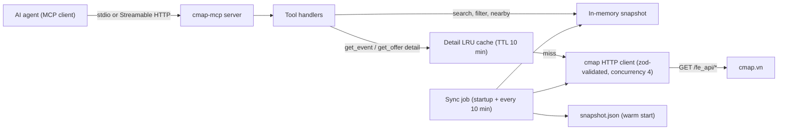

# Plan: an MCP server for cmap.vn

Status: draft for review. Investigation done 2026-11-08 against the live site.

## 1. What cmap.vn is

cmap.vn ("Bản đồ văn hóa", the culture map of Vietnam) is a Nuxt site rendered on the server. Its data comes from a public JSON API at `/fe_api/*`. That API is a proxy in front of a backend at `/api/*`, which looks like Django REST Framework. `robots.txt` allows every path (`Disallow:` is empty). None of the read endpoints need authentication.

| Dataset | Endpoint (all `GET`) | Size today | Notes |
|---|---|---|---|
| Events (cultural events and community activities) | `/fe_api/event/event?get_all=1&page=&page_size=` | 549 | Maximum 100 rows per page; vi and en translations |
| Event detail | `/fe_api/event/{id}?language=vi` | ~5 KB each | Adds the full `content` HTML, `ticket`, `image_list`, `checkin` |
| Slug → id | `/fe_api/event/resolve/{slug}` (also `offer/`, `position/`) | — | |
| Map view of events | `/fe_api/event/map?get_all=1&language=vi&translation_view=search` | 525 | One call, flat camelCase records, 710 KB |
| Facets (counts) | `/fe_api/event/facets?get_all=1` | — | `byProvince`, `byType`, `total` |
| Nearby | `/fe_api/event/nearby?lat=&lng=&limit=&language=` | — | Computed by the server |
| Offers (deals) | `/fe_api/offer/list?page_size=100` | 97 | `kind` is `event` (94) or `position` (3) |
| Positions (places) | `/fe_api/position/position?all=1&language=vi` | 3 | Lũng Cú flag tower, Hanoi Museum, Lý Sơn island |
| Provinces | `/fe_api/province/province`, `/fe_api/province/{id}` | 34 | Code, lat/lng, translations |
| Wards | `/fe_api/province/ward` | — | Turns `ward` ids into names |
| Taxonomies | `/fe_api/event/type` (4), `/fe_api/event/category` (2), `/fe_api/position/type` (6) | — | |
| Albums | `/fe_api/album/image`, `/fe_api/album/image-category` | — | Low value; leave out of v1 |

The full dataset is small, about 1.3 MB of JSON.

### Problems the investigation found

1. **List paging is unstable.** `total_objects` is 549, but paging through the list returns about 529 unique IDs. The same event shows up on two pages and others are never returned. No page contains a duplicate, so the server sorts on a non-unique key, probably `order`. Adding `ordering=id` changes nothing, and the upstream `/api` with 200 rows per page has the same problem. **Fix: query per province.** Every province has 100 events or fewer (the largest has 64), so each fits on one page. That returned all 549 events with no duplicates.
2. **The map and facets show 524–527 events while the list shows 549. This is a bug in the site, not a visibility rule** (confirmed with agent-browser on 2026-11-08). The Nuxt layer builds the index behind `/fe_api/event/map`, `/fe_api/event/facets` and `/fe_api/event/resolve/{slug}` by paging the backend 200 rows at a time. The backend's page breaks at rows 200 and 400 fall inside groups of events that share a start date: 68 events on 2026-11-18 and 32 on 2026-11-23. Because the sort order within those groups changes from one query to the next, each rebuild drops a different 23–27 events, all from those two dates. All of them are `PUBLISHED`, and their records never changed. Which events are missing changed three times in one hour. A missing event gets a **404 when its URL is opened directly or shared**, but loads normally when clicked from a listing card (in-app navigation passes the ID and skips the slug lookup). **Consequences:** never use `map`, `facets` or `resolve` as a source of truth. Resolve slugs from the snapshot, and fetch details only by ID with `/fe_api/event/{id}`, which always works. Optionally, tell the site operator (bandovanhoaso@bvhttdl.gov.vn); the fix is a unique tie-breaker such as `id` in the backend's default sort.
3. **The API is undocumented.** It is the site's own frontend API and can change without notice, so every response must be checked against a schema and a sync failure must not wipe the data already loaded.

## 2. How to collect the data: three methods compared

All figures were measured from this machine on 2026-11-08 with modest concurrency (5 to 8 requests at a time). Every request returned HTTP 200. I saw no rate limiting, bot challenge or Cloudflare in front of the site; the server is plain nginx.

| | A. Public JSON API (`/fe_api`) | B. Server-rendered HTML or `_payload.json` via the sitemap | C. Headless browser (Playwright or agent-browser) |
|---|---|---|---|
| Requests for a full crawl | ~40 (34 provinces, plus offers, positions and taxonomies) | 635 sitemap URLs (half are `/en` duplicates) | 635 page loads, plus the API calls each page makes |
| Measured time | 34 province calls at concurrency 8 took **6.1 s**. A single list or taxonomy call takes 0.12–0.4 s. 20 detail calls at concurrency 5 took 1.3 s. | 20 pages at concurrency 5 took 4.4 s, so about **140 s** for all 635 | 16.5 s cold start, then **2.4 s per page**. About 25 min serially, 5+ min with 5 browsers. |
| Bytes transferred | ~1.3 MB | ~75 MB (110–140 KB HTML per page; a `_payload.json` is 250 KB) | Larger than B, because it also loads JS, images and map tiles |
| Data quality | Typed JSON with both translations, IDs, lat/lng, taxonomy IDs | The data is buried in Nuxt's index-encoded payload (devalue format) and has to be decoded | Same as B, or scraped from the rendered page |
| Coverage | All 549 events if fetched per province | Only what the sitemap lists: 421 event URLs (vi and en), and new events wait for a sitemap update | Same as B |
| Fragility | Medium: an undocumented contract, but the frontend depends on it, so it changes rarely and on purpose | High: payload keys are hashed (`$f2ec95vauk6h0p`) and change on every build | High, and also slow and flaky |
| Load on cmap.vn | Lowest | About 50 times the load of A | Highest |
| Cost to run | Node `fetch`, nothing else | HTML parsing and devalue decoding | Chromium at roughly 300 MB+ of RAM per browser |

### Decision: method A, the public JSON API, read into an in-memory snapshot

- A full refresh takes about 6 seconds and about 40 requests, which is **at least 20 times faster than B and about 200 times faster than C**, with the best data quality.
- Keep B only as a **documented fallback**, used if `/fe_api` starts requiring a token. Don't build it in v1.
- C is unnecessary unless the site adds a JavaScript bot challenge.

Rules for collecting:
- At most 4 requests at a time.
- Send a descriptive User-Agent (`cmap-mcp/0.1 (+contact)`).
- Don't refresh more often than every 10 minutes. The site sets `cache-control: max-age=60` on API responses, so data changes slowly.
- Retry with backoff on 429 and 5xx responses.

## 3. Server architecture



**Why a snapshot rather than calling the site on every tool call:** the dataset is small (about 1.3 MB). The site's own search can't search without Vietnamese diacritics or combine filters, and paging through the list loses rows. A local snapshot answers searches in under 1 ms, never hits the paging bug, and keeps working when cmap.vn is slow or down. The large `content` HTML in detail records is the only data fetched on demand.

### State ownership
- The **snapshot** belongs to the sync job and is replaced in one swap. On any failure the last good snapshot stays. Its fields are `syncedAt`, `provinces`, `wards`, `eventTypes`, `eventCategories`, `positionTypes`, `events`, `offers` and `positions`.
- The **detail cache** belongs to the detail tools.
- The **search index** is built from the snapshot. It is the normalized text, with Vietnamese diacritics removed (NFD, drop combining marks, `đ` → `d`), across the vi and en `name`, `des`, `address`, `organizer` and `tags` fields.

### Sync algorithm
1. Fetch the taxonomies in parallel: provinces, wards, event types, event categories and position types.
2. Fetch events once per province with `page_size=100&get_all=1&province={id}`, at most 4 at a time. If a province reports `total_pages > 1`, page through it and record a warning.
3. Fetch offers and positions with one call each.
4. Remove duplicate events by `id`. Compare the count with `facets.total` and the list's `total_objects`, and log the difference rather than failing.
5. Validate with zod. An unknown extra field is allowed. A missing `id`, `translations` or `province` rejects that record and is logged. If more than 10% of records are rejected, the whole snapshot is rejected.
6. Swap the snapshot in and write `snapshot.json`, so the next start loads in 0 seconds.

## 4. MCP tools (v1)

Every tool takes `language: "vi" | "en"` (default `vi`) and returns `structuredContent` that matches an `outputSchema`, plus a short text summary. Records are compact by default: HTML is converted to plain text and cut to about 300 characters, IDs are resolved to names, and each record includes a `url` to the cmap.vn page.

| Tool | Input | Returns | Source |
|---|---|---|---|
| `search_events` | `query?`, `province?` (id, slug or name), `type?`, `category?`, `from?`, `to?` (matches events whose dates overlap the range), `free?`, `highlight?`, `limit` (≤50), `offset` | `{ total, items: EventSummary[] }` | Snapshot |
| `get_event` | `idOrSlug` | `EventDetail` (full content, ticket, organizer, contact, transport, all locations, images) | Live detail, cached |
| `events_near` | `lat`, `lng`, `radiusKm?`, `limit?` | `EventSummary[]` with `distanceKm` | Snapshot, haversine over all locations |
| `list_provinces` | none | Provinces with event counts | Snapshot |
| `get_province` | `idOrSlug` | Province detail with upcoming events | Snapshot |
| `list_taxonomies` | none | Event types, categories and position types (ids and names) | Snapshot |
| `search_offers` | `query?`, `province?`, `kind?`, `limit`, `offset` | `{ total, items: OfferSummary[] }` | Snapshot |
| `get_offer` | `idOrSlug` | `OfferDetail` | Live detail, cached |
| `list_places` | `province?`, `type?` | Positions | Snapshot |
| `get_sync_status` | none | `syncedAt`, counts, last error | Snapshot metadata |

Optional MCP resources: `cmap://provinces` and `cmap://taxonomies` (static JSON), so clients can load them as context.

"Community activities" are events whose `type` is *Sinh hoạt cộng đồng*, so `search_events` covers them through the `type` filter rather than a separate tool.

## 5. Technology

- TypeScript on Node 22+, using **pnpm**.
- `@modelcontextprotocol/server` (SDK v2.4). `StdioServerTransport` comes from `@modelcontextprotocol/server/stdio`. `WebStandardStreamableHTTPServerTransport` with `@modelcontextprotocol/hono` serves the optional HTTP endpoint. `registerTool` takes zod `inputSchema` and `outputSchema`.
- `zod` for the API contracts and tool schemas, and `p-limit` for concurrency.
- The plain built-in `fetch`, with no HTTP library.
- An `lru-cache` for details.
- No database in v1. If the dataset grows past about 50k records, swap the snapshot for SQLite with FTS5 behind the same `Snapshot` interface.

Layout:
```
src/
  index.ts             # entry: choose transport from argv/env
  server.ts            # builds McpServer, registers tools
  cmap/client.ts       # fetch + retry + concurrency + zod parse
  cmap/schemas.ts      # zod schemas for /fe_api responses (one place)
  cmap/sync.ts         # snapshot builder (algorithm in §3)
  snapshot/store.ts    # snapshot owner, atomic swap, disk persistence
  snapshot/search.ts   # VN-diacritic normalization, filters, geo
  tools/*.ts           # one file per tool group (events, offers, provinces)
test/
  fixtures/            # recorded /fe_api responses (trimmed)
  server.test.ts       # tests through the MCP client against the server
```

## 6. Implementation phases

1. **Scaffold.** Set up pnpm, tsconfig in strict mode, eslint and vitest, with `package.json` scripts `dev`, `build`, `test`, `lint`, `typecheck`, `record-fixtures` and `sync:once`. Create a git repo and a feature branch or worktree.
2. **API contracts.** Write the zod schemas from the recorded fixtures. Write `pnpm record-fixtures`, which saves trimmed real responses and is re-run when the site changes.
3. **Client and sync.** Build the per-province crawl, deduplication, validation, atomic swap and disk snapshot. `pnpm sync:once` prints the counts and the time taken. Target: under 10 seconds and 549 events.
4. **Search.** Diacritic-insensitive matching, filters, date overlap, and the nearby-distance calculation.
5. **Tools.** Register the ten tools with input and output schemas, and write the descriptions for an agent: when to use the tool and which IDs it accepts.
6. **Transports.** Stdio by default, and `--http :8787` for Streamable HTTP, stateless.
7. **Integration docs.** A README covering the Claude Code config (`claude mcp add cmap -- node dist/index.js`), the generic MCP client JSON, the environment variables (`CMAP_REFRESH_MIN`, `CMAP_CONCURRENCY`, `CMAP_SNAPSHOT_PATH`), and the attribution and polite-use notes.
8. **Hardening (optional).** A Dockerfile, plus a nightly "contract canary" job that runs `sync:once` against the live site and fails if the schema has drifted.

## 7. Testing

Tests cover what an agent relies on, and only through the public seam: an MCP `Client` connected to the server, with the server pointed at a **local fake cmap HTTP server that serves the recorded fixtures**. The tests use no `vi.mock` or spies.

- `search_events` with an unaccented query ("ha noi mua roi") finds the accented event, and the province, type and date filters narrow the results correctly.
- A sync against fixtures where the list pages overlap still returns every event exactly once. This is a regression test for the paging bug.
- A sync failure halfway through keeps the previous snapshot, and `get_sync_status` reports the error.
- `get_event` accepts either a slug or an id and returns the full content. An unknown id returns a tool error, not a crash.
- `events_near` sorts the results by distance and respects `radiusKm`.

I won't test zod itself, the HTTP retry helper on its own, or the SDK's wiring.

Verification gate: `pnpm lint && pnpm typecheck && pnpm test && pnpm build`, then `pnpm sync:once` against the live site, then a manual run of a tool through MCP Inspector or `claude mcp add`.

## 8. Risks and open questions

| Risk | Mitigation |
|---|---|
| `/fe_api` changes shape or adds authentication | Zod validation, keep the last good snapshot, the nightly canary job, and method B as the documented fallback |
| A province grows past 100 events | Page through that province and log a warning. Within one province the overlap is small; a final pass with `event/map` IDs can fetch any missed events by ID. |
| The 549-versus-525 gap (resolved: a paging bug in the site, see §1) | Keep all events from the per-province crawl. Resolve slugs locally, and never call `/fe_api/*/resolve`, `map` or `facets` for correctness. |
| Terms of use and attribution | `robots.txt` allows everything. Still, use low concurrency, cache the data, put the source URL on every record, and **check the site's terms or ask the operator before any commercial or public redistribution**. |
| `remove=false` and the ticket fields | The site passes `remove=false` when it wants ticketed events. Confirm what it changes during phase 2. |

## 9. Implementation notes (verified 2026-11-08)

Decisions made while building the core library, each checked against the live site.

- **Wards are not synced.** `/fe_api/province/ward` has 3 309 records and caps `page_size` at 100, so it costs 34 requests for names we do not need. Ward ids are not resolved; summaries carry no ward name. (The event detail response embeds the ward object if it is ever needed.)
- **`charge: true` means paid.** Checked against the data: the events with `charge: true` carry a `ticket` text (for example "Bán vé tại Nhà hát Múa rối Việt Nam"). `free` filters on `charge !== true`.
- **No offer detail endpoint.** `/fe_api/offer/{id}` returns 404. The offer list record already carries the full `content` and `ticket`, so `getOffer` returns the snapshot record. Offers of kind `event` share their id and slug with the event.
- **Canonical page URLs.** Events: `/su-kien/{slug}`; community activities (event type slug `sinh-hoat-cong-dong-…`): `/sinh-hoat-cong-dong/{slug}`. The other path answers 301. Offers of kind `position` and places: `/uu-dai/{slug}`. Provinces: `/cac-diem-den/{provinceId}`; the slug form 404s.
- **Shape quirks the schemas accept.** In event detail responses `province`, `ward` and each `category` are nested objects rather than ids; `more_location_list[].ward` can be an object; position `type` is an array of ids; 14 of 549 events have no `en` translation; one event has a corrupt latitude (210107), so geo search ignores coordinates outside [-90, 90] / [-180, 180].
- **Rate limiting exists.** Rapid sequential detail requests eventually get HTTP 429. The client retries with exponential backoff (400 ms doubling, 3 retries, honouring `Retry-After`), and `getEvent` falls back to the snapshot record (`source: "snapshot"`) if the live detail stays unavailable.
